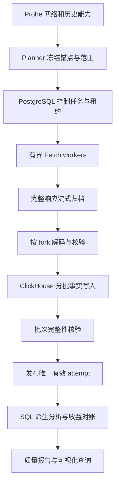

# EthVis2 数据收集器代码设计

日期：2026-10-26。本文记录目标代码架构；目前已实现 Go 1.27.3 + Node.js 24.22.1 的 v0.1，实际 CLI、HTTP 写入方案和已实现范围见 [README.md](README.md)。下文较完整的状态重放、EL 和发布架构仍包含后续目标。

数据范围、完整字段和分析口径沿用 [DATA_COLLECTION_DESIGN.md](DATA_COLLECTION_DESIGN.md)。已确认：ClickHouse 分析主库、PostgreSQL 控制库、近期 finalized 连续区间的 100000 个实际 canonical Beacon blocks，含空 slot 时间轴和结算支持区间。

## 1. 语言选择：采集器用 Go，分析用 SQL，Python 用于研究

**建议采集器主体用 Go。** 首轮先做单机 CLI + 有界 worker pools，不引入微服务、Kafka 或 Airflow。全量事实与派生分析在 ClickHouse 执行；Python 用于样本核验、统计探索和绘图，不把全部 validator-epoch 明细拉进 pandas。

| 考虑 | Go | Python | 本项目选择依据 |
| --- | --- | --- | --- |
| 现有参考代码 | chaind 是 Go，具有 fork/委员会/历史采集实现 | reward 仓库用 requests/web3/pandas | 采集结构更接近 chaind，分析更接近 reward |
| 多端点采集和限流 | context、HTTP 连接复用、有界并发便于统一管理 | asyncio/httpx 同样能实现 | 不是 Python 不能并发；Go 更便于与现有类型和模块衔接 |
| 数据模型 | root/pubkey/uint64 等可用显式类型 | 也可用类型标注和校验库 | 本项目有大量 fork 差异和金额边界，倾向编译期约束 |
| 内存与大结果 | 可流式解码、边读边写，需避免巨型切片 | 同样可以流式，需避免 DataFrame 放大全量数据 | 关键是算法和批次设计，不能只凭语言承诺性能 |
| 部署 | 可以构建单个 CLI 可执行文件 | 需要管理运行环境和 Python 依赖 | 本地长期回填偏向简单进程部署 |
| 探索和图表 | 需要额外工具 | 研究生态便利 | 保留 Python 作为分析辅助 |

Go 不会解决节点历史 state 重建慢、磁盘 I/O 和数据库设计问题。性能需从 100/1000 blocks 的真实样本测量，不能提前承诺吞吐。

不直接把 chaind fork 成整个应用，不实现一个替换 PG 驱动就完成的“ClickHouse 版 chaind”。复用其客户端、类型和解析思路，单独建立范围受控、先归档再解析的 EthVis2 数据管线。

## 2. 本次参考代码与复用边界

### 2.1 本地版本

| 仓库 | 本地路径 | HEAD |
| --- | --- | --- |
| chaind | `/home/chen/GitHub/Archived/chaind` | `77bef5cae806afd0ea8715ca0e7b1898d5a8d8c6` |
| ETH2.0-reward | `/home/chen/GitHub/Archived/ETH2.0-reward` | `dd22adad105a0b27240eb19bd97dc1eadea7e794` |

本次实际读取了归档源码，而非仅依据旧路径或 README。

### 2.2 chaind 中参考什么

| 本地文件 | 用途 | 新实现的边界 |
| --- | --- | --- |
| `../Archived/chaind/go.mod` | 客户端和 PG 依赖 | 参考锁定版本，不复制整份依赖树 |
| `../Archived/chaind/services/blocks/standard/handler.go` | fork 分派、operations、委员会映射 | 改为冻结范围任务；保留完整原始响应 |
| `../Archived/chaind/services/beaconcommittees/standard/handler.go` | 历史委员会采集 | 带历史 state/dependent root 上下文 |
| `../Archived/chaind/services/synccommittees/standard/handler.go` | sync committee 映射 | 保存位置，不提前去重 validator |
| `../Archived/chaind/services/validators/standard/handler.go` | epoch 余额读取 | 不用 head registry 解释历史；不省略零余额 |
| `../Archived/chaind/services/chaindb/types.go` | 共识对象字段和关联 | 自有模型增加签名、原始对象、版本与质量状态 |
| `../Archived/chaind/services/chaindb/postgresql/` | 事务与读写组织参考 | 不承接其链上明细表到 PG 控制库 |

chaind 的 catchup 追到 CurrentSlot，不能满足固定终点；其 DB Block/Attestation/SyncAggregate 类型没有完整外层/投票签名，ExecutionPayload 明确省略 transactions。新采集器必须在类型化解析之前完整归档返回体，避免同样丢失信息。

其 balances 获取 epoch 首 slot 的 validators，跳过 0 余额；registry 更新读 head。新模型显式保存历史状态根、真实 state slot、边界种类、零值和字段存在性。

如直接摘取上游代码，保留 Apache-2.0 许可和版权标识，并记录来源 commit；首选依赖公开客户端、参考算法后编写自有适配层，不把 daemon 当成稳定库 API。

### 2.3 ETH2.0-reward 中参考什么

三类 collector 提供接口思路：proposer 按 block，attestation 按 epoch，sync 按 block；epoch/day 聚合提供分析需求。对应文件在 `../Archived/ETH2.0-reward/code/data_collection/`。

不沿用以下实现方式：

- 非 200 直接返回 None 后跳过，无法区分缺块与采集失败。
- `eval` 解析节点数字、固定 genesis time、写死端口/文件范围。
- 将同步委员会数组当作单个字典、对已经解码 JSON 再次 json.loads。
- 只保存 head/target/source，不保留 inactivity、ideal rewards 和适用的 Phase0 分项。
- 一次加载多个大 parquet/DataFrame、拼接字符串模拟复合主键。
- 未先处理数据覆盖就把缺失填 0，或 let join 后 NaN 扩散到总收益。

该仓库 requirements 同时固定两个不同 numpy 版本，不能原样当作新项目依赖文件。

## 3. 技术栈与依赖策略

| 职责 | 候选 | 使用边界 |
| --- | --- | --- |
| HTTP、日志、JSON、精确整数 | 标准库 net/http、log/slog、encoding/json、math/big | 共用 Transport；超时与取消；金额不经 float64 |
| 共识类型/SSZ/fork | `github.com/attestantio/go-eth2-client` | 归档 chaind 锁定 v0.27.1，作为兼容性评估基线，非断言最新或适用所有未来 fork |
| PG 控制库 | `github.com/jackc/pgx/v5/pgxpool` | 任务租约、清单、事务及发布状态 |
| CH 事实库 | `github.com/ClickHouse/clickhouse-go/v2` | 官方 Go 驱动、native batch，固定实际通过测试的版本 |
| 配置 | 一个 YAML 解析库 + 显式环境变量覆盖 | 保持单套配置，不复制 chaind 的全部 viper 配置体系 |
| 压缩归档 | gzip 起步，可选固定版本 zstd 库 | codec 隔离，校验保存的 bytes |
| 并发 | 有界 channels、context，可选 x/sync/errgroup | 独立请求超时不取消整个 pilot，致命网络身份冲突才停止范围 |
| 分析 | 版本化 ClickHouse SQL + 可选 Python notebooks | SQL 流程独立于采集状态机 |

实施时固定 Go 工具链与 go.mod/go.sum，用本地节点样本验证依赖。归档 chaind 的 go.mod 指定 Go 1.22.7/toolchain 1.23.2，这只是其历史构建信息，不据此推荐旧工具链。

已核查的官方入口：[ClickHouse Go](https://clickhouse.com/docs/integrations/go)、[go-eth2-client](https://github.com/attestantio/go-eth2-client)、[pgxpool](https://pkg.go.dev/github.com/jackc/pgx/v5/pgxpool)。HTTP 连接复用见 [net/http](https://pkg.go.dev/net/http#Transport)，动态 JSON 数字精度处理见 [UseNumber](https://pkg.go.dev/encoding/json#Decoder.UseNumber)。

## 4. 代码布局

以下是拟创建目录，不表示目前已有实现：

```text
cmd/ethvis-collector/main.go      # 参数、信号、退出码，不放业务逻辑
internal/config/                 # 配置、默认值、检查、脱敏
internal/domain/                 # Root、Slot、Epoch、金额、上下文与记录契约
internal/probe/                  # 节点身份、能力与范围样本
internal/planner/                # frozen manifest、10万roots、support范围、任务图
internal/scheduler/              # PG claim/lease/heartbeat/retry/backpressure
internal/source/beacon/          # REST请求构造与返回元数据
internal/source/execution/       # Geth JSON-RPC、receipt fallback
internal/source/transport/       # 限流、重试、raw流式归档，共用连接
internal/archive/                # 本地对象、checksum、原子提交、恢复检查
internal/decode/beacon/           # fork适配、SSZ/JSON、operations
internal/decode/execution/        # tx/receipt/log，无损金额与数量
internal/collect/                # dataset handlers，仅编排接口
internal/boundary/               # 精确状态边界解析与已验证provider
internal/control/postgres/       # PG任务、attempt、manifest repository
internal/facts/clickhouse/       # schema映射、分批写入、读取校验
internal/publish/                # 批次一致性、冻结发布清单
internal/validate/               # parent、bits、coverage、金额/余额对账
internal/observe/                # 指标、进度、容量与质量报告
migrations/postgres/             # 控制表DDL，显式执行
migrations/clickhouse/           # 事实表及读视图DDL
analysis/sql/                    # 版本化派生表和验收查询
analysis/python/                 # 可选样本交叉验证与绘图
configs/collector.example.yaml   # 不含真实凭据
spec/fixtures/                   # 小型fork/奖励/边界样本及来源
```

不预先建立插件系统；先用显式 handler 注册表。domain 不依赖数据库驱动，planner 不直接发数据写入，parser 不拥有 HTTP 连接。

## 5. 整体管线与任务依赖



任务按数据依赖安排，不能把每个 block 的一切都串行完成再处理下一块，也不能一次并行请求 10 万个 blocks。

| Task kind | 输入粒度 | 依赖 | 产物 |
| --- | --- | --- | --- |
| `block_raw` | 已冻结 block root | network + manifest | 完整响应、block/header/body |
| `block_decode` | raw object + parser version | block_raw | block/operations/payload facts |
| `epoch_context` | epoch + branch/state context | boundary resolver | historical validators、余额、participation、checkpoint |
| `epoch_committees` | epoch + state | frozen branch | 有序委员会 |
| `proposer_duties` | epoch/context | capability | 计划 proposer；历史接口不可用时需另有验证过的 provider |
| `sync_members` | period/context | state | sync positions |
| `attestation_map` | block raw | 对应历史 committees | 成员/位置映射；可推迟长表展开 |
| `proposer_reward` | block root | reward capability | proposer 分项 |
| `sync_reward` | block root | fork/capability | validator 级 sync 净额 |
| `attestation_reward` | rewarded epoch/context | 所需结算状态 | actual + ideal + 字段存在性 |
| `execution_block` | payload hash | block_decode | EL block/tx |
| `execution_receipts` | EL block hash | execution_block | receipts/logs/tips 输入 |
| `state_checkpoint` | 精确 state identifier | capabilities/context | SSZ 完整快照 |
| `validate_range` | manifest 范围 | required datasets | coverage、统计、residual |
| `derive_range` | publication id + SQL version | 已发布完整事实 | 派生表/分析报告 |

所有子任务只来自 manifest 的 core/support 集合，禁止模块自行追 head 或从 genesis 扫起。先抓 raw 再解码，可以在未知 fork 或 parser 修复后离线重跑。

## 6. Manifest 与范围算法

### 6.1 核心元数据

Run manifest 包括：network identity、probe id、anchor finalized root/epoch、core end/root、100000 roots 清单对象及 hash、起止 slots、core/support/epoch/period 集合、结算状态引用、配置 hash、parser/schema/rule versions、所需数据集、创建时间。

Block roots 清单存归档文件/CH，PG 只存对象索引和少量范围配置，不将每个 validator 行写入控制库。

### 6.2 选择近期范围

1. probe 返回真实 finalized 锚点；只有确定历史 rewards 所需后续状态已具备时才选择 core end。不能仅用“向前退固定两 epochs”替代能力验证。
2. 按 parent root 回溯核心连续链，包含 end 共计 100000 个不同 roots；核验 slot 递减及网络身份。已经取得的完整 blocks 直接归档复用，不再重复请求。
3. 为减少 planning 开销，可先取 headers 建 root 清单，fetch 阶段再取完整 blocks；两种方式不能混淆 header 完成与 block 采集完成。
4. 首尾补齐完整 epoch、parent、有效包含窗口、奖励结算及对账支持区间，标明支持对象用途。
5. 将范围标记 frozen，之后 resume 复用相同 manifest，不重新把 recent 理解为今天的另一段。

100/1000 smoke 是同一 frozen 范围的子集。`core_block_count=100000` 是完整目标；smoke manifest 保留 subset 与 parent run 关系。

## 7. 核心 Go 接口契约

以下片段表达接口边界，正式实现需补齐构造、类型、错误和测试，不宣称可独立编译。

```go
type Root [32]byte
type Slot uint64
type Epoch uint64
type ObjectID string
type TaskID string
type AttemptID string

type RawRef struct {
    ID           ObjectID
    URI          string
    SHA256       [32]byte // 已提交归档bytes的hash
    PayloadHash  [32]byte // 声明编码下响应payload的hash
    Bytes        uint64
    Encoding     string
    Compression  string
}

type RequestSpec struct {
    Source       string // beacon / execution
    Method       string
    Path         string // RPC使用固定端点，方法放在body元信息
    Body         []byte // 小请求体；不含凭据
    ContextID    string // immutable网络/分支/奖励上下文
}

type FetchResult struct {
    Raw          RawRef
    HTTPStatus   int
    ResponseMeta ResponseMeta // RPC错误、版本、finalized等；缺失保持缺失
}

type Fetcher interface {
    FetchToArchive(context.Context, RequestSpec) (FetchResult, error)
}

type Archive interface {
    Put(context.Context, io.Reader, ObjectMeta) (RawRef, error)
    Open(context.Context, ObjectID) (io.ReadCloser, error)
    Verify(context.Context, ObjectID) error
}

type Decoder interface {
    Decode(context.Context, RawRef, DecodeContext, RowSink) (DecodeReport, error)
}

type RowSink interface {
    Append(context.Context, FactRow) error
    Flush(context.Context) (ChunkReceipt, error)
}

type TaskHandler interface {
    Kind() TaskKind
    Run(context.Context, TaskLease) (AttemptResult, error)
}

type ControlStore interface {
    Claim(context.Context, WorkerID, []TaskKind) (TaskLease, error)
    Heartbeat(context.Context, TaskLease) error
    RegisterRaw(context.Context, TaskLease, RawRef) error
    MarkValidated(context.Context, TaskLease, AttemptResult) error
    CommitPublication(context.Context, PublicationProposal) (Publication, error)
    Fail(context.Context, TaskLease, ClassifiedError) error
}
```

`TaskLease` 带 lease token/fencing generation，所有状态提交必须条件匹配，防止过期 worker 把新 worker 的结果标完成。取消传播到 HTTP、PG、CH 和归档；发布操作独立校验尝试和覆盖。

金额 domain 使用 `uint64` Gwei/`int64` signed rewards、`big.Int` EL 值或经过验证的 256-bit 类型；大总和提升精度。JSON 数字若进 any/map 必须 UseNumber，协议数字字符串严格解析；不允许默认 float64 中转。signature/root 固定长度校验，不以任意 string 代替全部内部标识。

字段 presence 与 value 分离，例如 `Optional[int64]`，区分 0、不适用和未返回。Reward 分项保持 signed 原值，净额和跨层单位转换由 versioned SQL/规则明确计算。

## 8. 原始归档与客户端复用

### 8.1 原始数据先于类型化对象

单独 source transport 返回完整响应流，完整保存 envelope/body；然后从归档解码到客户端提供的版本类型/自有 DTO。对于公共 API 没有稳定的离线 decoder，则写薄适配器，不依赖库内部未导出实现。

如改用 go-eth2-client 发请求，需要先验证它的 transport hook 能保留完整 body、响应头与失败响应；不能仅调用 SignedBeaconBlock 后把已解析的 message 重新 marshal，就把它叫原始响应。

普通大 validators/rewards JSON 使用 token/数组迭代，`ideal_rewards` 可小量保留，`total_rewards` 边解码边批写；不把单 epoch 数百万 validator 先装入多个 map。确实需要随机访问的委员会采用有容量上限的 epoch/context 缓存。

### 8.2 本地对象提交

建议概念路径：

```text
archive/objects/sha256/ab/<hash>.json.gz
archive/objects/sha256/cd/<hash>.ssz.gz
archive/manifests/<run_id>/<revision>.json
archive/tmp/<attempt_id>/<request_id>.partial
```

HTTP 解压前后哪一种 bytes 被保存必须固定声明；建议保存客户端收到并按声明 Content-Encoding 处理后的 payload bytes，再压缩到自己的归档 codec，响应头保留原始编码信息。不声称还原了 TCP 线上的字节流。

同一文件系统先写临时文件、同步数据、校验长度/hash，再 atomic rename；目录持久化按平台处理。成功后登记 PG 索引。失败半文件不成为有效对象，已有相同 hash 可复用。归档成功但 PG 提交失败时由 recovery 扫描并校验后认领，不立即删除。

压缩 codec/header 确定性与 payload hash 分离。未知版本和错误响应也归档，解析状态独立；大响应不得因一个固定小 body limit 被截断后仍标成功，超过明确资源预算应保存失败/partial状态并重试或分批。

## 9. PG 控制库与调度

### 9.1 控制表

| 表 | 核心字段/约束 |
| --- | --- |
| `runs` | run_id、network、manifest_ref/hash、status、frozen_at、版本 |
| `tasks` | task_id、run_id、kind、identity/context、state、lease_owner/until/token、next_retry_at；自然任务键 UNIQUE |
| `task_dependencies` | task_id、depends_on；只保存任务依赖 |
| `task_attempts` | attempt_id、task_id、lease token、开始/结束、错误类别、raw/chunk refs、状态 |
| `archive_objects` | hash/URI/size/encoding、验证状态；无大响应正文 |
| `fact_chunks` | attempt_id、table、chunk index/hash、行数、范围、写入及核验状态 |
| `publications` | publication_id、run、manifest revision、required datasets、已选attempt清单对象、status |
| `quality_checks` | check id/type/range、pass/fail、计数、详情对象引用 |
| `node_capabilities` | probe版本、网络、端点、历史样本与已验证能力 |

避免 PG 存每 validator 的任务或质量行。Epoch / validator request shard 是任务粒度，行级细节报告放 CH/归档。Task 依赖不展开成全部 block × 全部 validator 的笛卡尔积。

### 9.2 Claim 与恢复

PG 短事务使用 `FOR UPDATE SKIP LOCKED` 取到依赖已完成且到期可运行任务，分配有限租约；取到后提交事务再做网络请求。不持有数据库行锁等待 Teku 响应。

Heartbeat 延租需匹配 token；超时任务可重新 claim。旧 worker 即使迟到也不能发布。Attempt 永不复用作新执行；原始对象可以复用。

任务状态：`pending → leased → raw_ready → facts_ready → validated → published`，另有 `retry_wait / unsupported / not_applicable / failed`。单任务解析完成不等于 run 完成；整个 run 按 manifest 检查全部 required datasets。

## 10. CH 幂等、跨库发布与查询正确性

### 10.1 不承诺分布式事务

文件、PG、CH 之间没有自动原子提交。只依靠“PG 状态已完成”或 CH PRIMARY KEY 不能证明 exactly-once。实现目标是**可恢复的 at-least-once 执行 + 对读者唯一的已验证结果**。

每条事实包含稳定自然 row identity、context、run/version、attempt_id、chunk_id、payload hash。Batch/chunk 边界与排序确定化；同一 row identity 内容冲突要失败，不能由最后一个值静默覆盖。

### 10.2 写入与发布协议

1. Claim task，产生新 attempt，归档响应并登记。
2. 解析到有限 batch，CH 收到同步确认后核验 chunk 的逻辑行数、key集合/hash及内容一致性，记录 chunk receipt。
3. CH 发送超时结果不确定时，先查询校验；无法证明完整则放弃该 attempt，为该任务重新开始新 attempt。不要原地追加同一 chunk 后直接认为无重复。
4. 所有目标表 chunks、归档和质量检查通过后，PG 用匹配 lease token 的事务记录 validated，并将某 task/context 的唯一有效 attempt 纳入 publication proposal。
5. 冻结全范围 publication 清单；对应 CH 发布索引完成并回读验证后标记对查询可见。PG 与 CH 中途崩溃由独立 publisher 幂等补齐。
6. 消费者只读取指定 publication 的已选 attempts，先逻辑去重，再聚合。失败/过期/被替代 attempt 的物理行都不可见。

发布索引本身也必须幂等：按 publication + task/context 聚合为一条已选 attempt；相同键内容矛盾拒绝发布，不能用普通多行 join 放大结果。

### 10.3 行级去重与性能

即使在同一 attempt 内，驱动重试也可能产生重复物理行。读视图必须在自然 identity + attempt 范围做一致的逻辑去重（例如已验证相同 payload 的 argMax/分组），不能仅用 `WHERE attempt_id IN (...)` 就宣称正确。

初期可用版本表/去重视图验证 correctness；量大时按已验证 chunks 构建稳定服务表，经过校验后切换 publication，避免每次图查询都扫描几十亿行去重。ReplacingMergeTree 后台合并不是唯一性保证，原始插入表不直连增量 sum 物化视图。

Chunk 校验区分物理行数、不同 row identity 数和内容 hash；count 相同不足以证明数据一致。Checksum 算法、行序与规范编码必须固定。

## 11. 历史状态和收益的关键契约

### 11.1 BoundaryResolver

输入：network + frozen branch + epoch + required boundary kind。

输出：真实 state root/slot、pre/post-block 属性、取得方式、关联 block、版本和验证证据。不能只返回一个 `epoch*32` 字符串就视为解决边界。

优先使用节点能实际返回且可核验的精确状态。若需要 pre-block state 而节点仅提供 post-block，必须使用已验证的 state provider/replay adapter；不在采集器中临时重写整套以太坊状态转换。

无法满足时任务进入明确的 unsupported/dependency 状态，原始 blocks/rewards 可继续归档，但对应范围不能发布为“已完成精确余额对账”。状态重放是独立且需验证的能力，不在首个 HTTP collector 中用近邻 state 冒充。

### 11.2 RewardContext

Proposer/sync 尽量按 block root 请求。Attestation epoch API 不支持 root 参数时，记录请求前后的 finalized/canonical anchor、所需后续状态引用、响应 hash，验证属于 frozen branch；上下文不能确定则不发布。

有符号 head/target/source/inactivity 原样保留；`ideal_rewards` 按有效余额档位单独存；Phase0 字段按 presence 保留。Sync 返回 validator 级 reward，committee positions 是另一张事实表，不能按 positions 复制金额。

CL 余额核对必须调整实际应用的 deposits、withdrawals、consolidation；请求出现不等于资金已入账。Slash 延后扣款和余额扣到零需精确状态/重放支持；残差不能自动填平。

### 11.3 Execution context

按 payload hash 查 EL block、tx、receipts，receipt.blockHash 必须一致。若 `eth_getBlockReceipts` 不支持，按明确 tx list 分批取单 receipt。每次 JSON-RPC batch 通过 id 匹配响应，不能依赖数组顺序；HTTP 200 内也可能有 RPC error。

Tips 通过 receipt.gasUsed × (effectiveGasPrice - baseFeePerGas) 精确计算，未覆盖 receipt 则该 block tips 为 unknown。完整 MEV 及持有人净利润需要额外来源，不能以 fee recipient balance delta 直接代替。

## 12. 并发、重试、资源预算

初始建议值仅用于配置基线，probe/smoke 后调整：

| 请求/处理 | 初始并发 | 说明 |
| --- | ---: | --- |
| Beacon blocks/headers | 4 | parent planning 有依赖；冻结后可并行 fetch |
| committees/duties | 2 | 缓存按 epoch/context，避免逐 attestation HTTP |
| validator/state | 1 | 历史状态恢复和 SSZ 响应可能很重 |
| rewards | 2 | 全 validators 按经验证的接口分批/流式处理 |
| Geth blocks/receipts | 4 | batch大小单独限额 |
| trace | 1，默认不全量开启 | 与普通 EL 请求隔离预算 |
| CH writers | 2 | 有限 rows + bytes 双阈值，不逐行 insert |

所有类别还共享 node-level 总并发预算；请求数、in-flight bytes、decoder 内存和 CH pending batches 均有上限。初始 CH batch 可取最多 20000 行或 16MiB，任一达到就 flush，具体按宽行/数组实测调整。

超时配置区分连接、响应头、stream idle、整体上限；大 state 允许更长但有界的时长。重试带指数退避、jitter、Retry-After 和最大 attempt；deadline/cancel 不当作普通重试。单个可重试任务失败不让全部数据丢弃。

错误至少包括：transport、rate_limited、server_error、rpc_error、not_found_unclassified、history_unavailable、unsupported_api/fork、invalid_schema、integrity_mismatch、storage_error、lease_lost、context_mismatch。404 不是默认 skipped；401/403 不循环重试；未知 fork 仍先归档。

磁盘低于预留预算或 CH backlog 过大时停止 claim 新大任务，已有请求可归档/结束，不靠内存无限排队。SIGTERM 停止 claim、取消请求、有限时间 flush；未完成 lease 可恢复，绝不提前标 published。

## 13. 配置与 CLI 契约

以下是拟实现示例，当前不能执行：

```yaml
network: mainnet
sources:
  beacon_url_env: ETHVIS_TEKU_URL
  execution_url_env: ETHVIS_GETH_URL
stores:
  postgres_dsn_env: ETHVIS_PG_DSN
  clickhouse_dsn_env: ETHVIS_CH_DSN
  archive_dir: ./var/archive
pilot:
  mode: recent_finalized
  core_block_count: 100000
  support_policy: fork_aware
resources:
  beacon_light_workers: 4
  state_workers: 1
  reward_workers: 2
  execution_workers: 4
  max_beacon_inflight: 6
  max_execution_inflight: 4
  max_inflight_bytes: 268435456
  max_batch_rows: 20000
  max_batch_bytes: 16777216
  min_free_disk_bytes: 53687091200
required:
  - blocks
  - operations
  - historical_context
  - committees_and_duties
  - rewards
  - execution_blocks_and_receipts
```

资源预算包括磁盘预留示例，不是最终全范围容量承诺。URL/DSN 从环境变量读取，日志不打印凭据。Config hash 使用脱敏后的结构与凭据无关标识，不把 secret 原文哈希当公开配置。

```text
ethvis-collector probe --config configs/local.yaml
ethvis-collector plan --config configs/local.yaml --core-blocks 100000
ethvis-collector collect --run <frozen-run-id> --subset 100
ethvis-collector collect --run <frozen-run-id> --subset 1000
ethvis-collector collect --run <frozen-run-id>
ethvis-collector status --run <frozen-run-id>
ethvis-collector validate --run <frozen-run-id>
ethvis-collector publish --run <frozen-run-id>
ethvis-collector derive --publication <id> --rules <version>
ethvis-collector report --publication <id>
```

Resume 由相同 `collect --run` 实现，不重选 recent 范围；subset 不发布整个 run。Probe 不创建数据库或修改节点。Migration 使用单独显式命令，采集进程不自动升级生产 schema。

## 14. 实现顺序与有意义的验证

| 里程碑 | 实现内容 | 验收 |
| --- | --- | --- |
| M1 | config、probe、raw transport/archive、frozen planner | 固定 network/anchor，精确 core roots，不越界；大响应流式落盘 |
| M2 | PG lease、Go workers、CH block/operations writer、publication最小闭环 | 100 blocks 全链路，失败重试与崩溃不重复累计 |
| M3 | committees、历史状态、duties、三类 rewards、Geth receipts | 1000 blocks + 完整支持epochs，收益和余额边界可核验 |
| M4 | 版本化 SQL、coverage/reconciliation/report | 100000 blocks 全范围，完整性和性能报告 |
| M5 | 可选 traces/relay、实时观测与全历史扩展 | 不改变已发布事实的语义 |

优先验证的测试：

- fake Beacon/RPC server：429/5xx/404、HTTP 200 RPC error、乱序 RPC batch、半响应、未知 fork、负 rewards。
- fork 样本：Electra 多 committee bit 映射、sync 同 validator 多 positions、完整签名和未知字段归档保留。
- planner：100000 个实际 roots、有 skipped slot、epoch 边界及 frozen resume 不变化。
- 归档恢复：写半文件、归档成功后 PG 失败、hash 错误对象不可见。
- 控制/发布集成：lease 过期双 worker、CH 接收后超时、CH 已写 PG 未提交、publication mirror 中断；最终查询不重复金额。
- 数据一致性：uint64 哨兵、超过 2^53 数字、Wei 大整数、零/缺失区分、rewards 组件、receipt/hash 对应。
- 真实节点样本：state boundary、完整 reward context、deposit/withdrawal/consolidation/slash 对账；没有事件则另取小支持样本，不能伪造覆盖。

实际实现后才执行 Go 编译/单测/集成及真实节点检查。本文未安装依赖、未生成可执行文件、未运行上述命令或采集链上数据。

## 15. 与前一份设计的关系

`DATA_COLLECTION_DESIGN.md` 回答“采什么、为什么、怎样对账”；本文回答“程序如何组织、怎么恢复、何时能称为完成”。后续实现以两份文档的共同约束为准。

首轮推荐采用：**Go CLI + go-eth2-client 适配层 + pgx 控制库 + ClickHouse native batch + 本地完整归档 + 版本化分析 SQL**。Python 保留在研究与交叉验证层。暂不需要将 chaind 原样运行到 PG 明细暂存，也不需要重写整个共识客户端。
