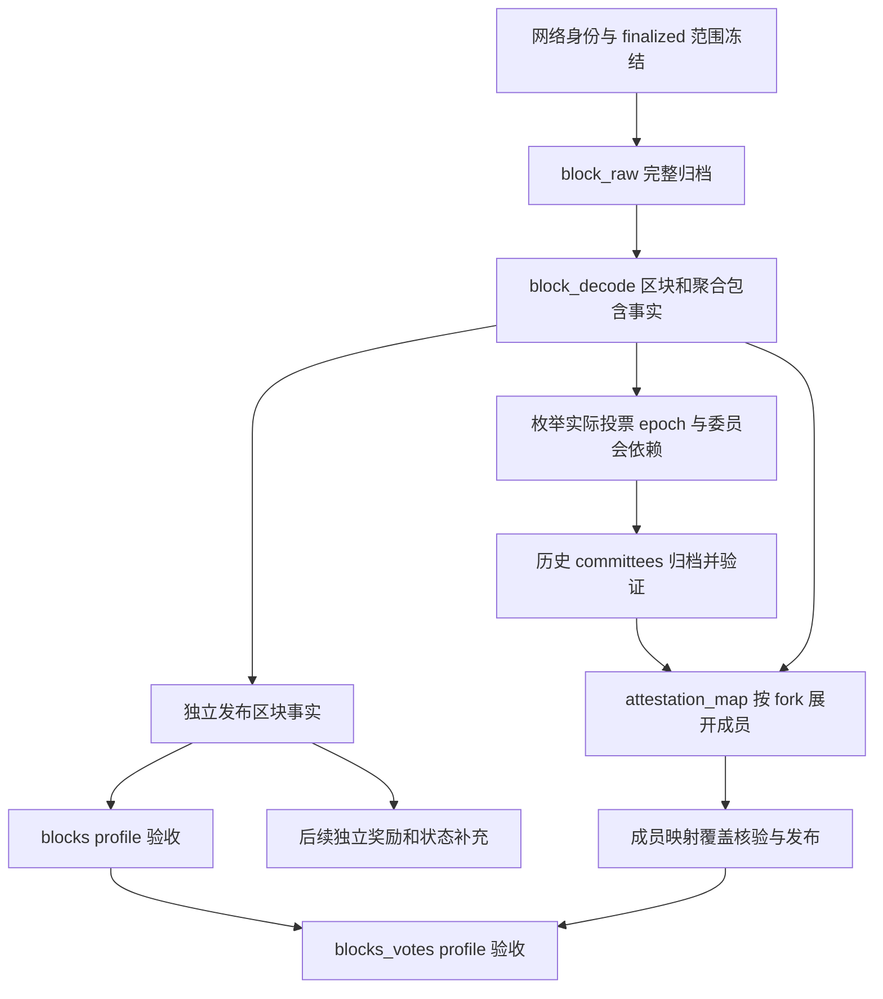

# EthVis2 数据收集器代码设计

修订日期：2026-10-30。

本文规定采集器实现契约和后续目标。活动 CLI 已切换到 v0.3.0（schema v3）：Go 1.27.3 采集、Node.js 24.22.1 独立核验，ClickHouse 为分析事实库、PostgreSQL 为控制库、本地 gzip 保存原始响应。第 16 节记录本轮实际实现和验证边界；运行说明见 [README](../README.md)。

本轮优先目标：冻结近期已 finalized 的区间，先用 100 个实际 canonical blocks 跑通，再扩展到 100000 个；完整保存区块内容，并将 aggregated attestations 展开为可按 validator 查询的投票包含记录，用于重构旧 EthVis 弧形图。收益明细、余额和收益聚合独立推进。

[DATA_COLLECTION_DESIGN.md](DATA_COLLECTION_DESIGN.md) 保留长期全量数据需求；涉及本轮任务范围、依赖和完成条件时，以本文修订为准。

## 1. 重构前的问题与本轮边界

重构前检查了 `internal/collector/records.go`、`store.go`、`run.go` 和 `verify.go`：

- `collectBlock` 先读取完整区块，再请求 proposer reward、sync reward；奖励接口失败导致整个 block task 失败，不能发布该次已拆解区块事实。
- `tasksFor` 固定创建 validators、committees、proposer_duties、checkpoints、attestation_rewards 等任务；当前 collect/verify 将其共同作为完成要求。
- v0.2 的 validators 分批缓存降低单次响应体积，但仍需查询历史状态；这不是取得区块正文或识别 attestation 成员所必需的全量注册表。
- 当前 attestations 保留原始对象，但尚未形成本文要求的 validator 投票长表。

日志里的 HTTP 500 / `Request Timeout` 表示节点或请求服务端主动结束请求；加长采集器 HTTP 总超时不能改变服务端预算。具体历史状态耗时原因需要 Teku 日志和资源观测，不能仅凭状态码断言。当前阶段应先解除不必要的接口依赖。

### 1.1 明确的模式与验收范围

| 模式（v0.3） | 目的 | 必需任务 | 默认不调度 |
| --- | --- | --- | --- |
| `blocks` | 仅归档、拆解区块 | 网络/冻结范围、block_raw、block_decode、slots、区块覆盖核验 | 全量 validators/balances、rewards、duties、state SSZ、Geth receipts |
| `blocks_votes`（新 run 默认） | 区块 + 每个 validator 的 attestation 包含明细 | `blocks` 全部要求 + 历史 committees + attestation_map + 映射覆盖核验 | 全量 validators/balances、所有 rewards、duties、state SSZ、Geth receipts |
| 独立补充 profile | 后续收益及其他分析输入 | 按显式 profile 选择奖励、余额、职责、同步委员会或 EL 输入及各自覆盖核验 | 不隐式绑定到区块采集 |

用户当前“仅区块采集并拆解 aggregated attestation”的实际需求对应 `blocks_votes`。保留纯 `blocks` 模式，使历史委员会暂不可用时仍能完成区块归档；但纯区块完成不能宣传为 validator 级投票可查。

“无需额外计算”在本阶段指不计算收益、收益率、余额对账及图表聚合。bit 解码、委员会成员映射、字段校验和投票索引是必要的数据解码与组织工作，应在当前阶段完成。

### 1.2 “不要求 validators/rewards 任务成功”的准确含义

全量 validators 和 rewards 不属于上述两个 profile 的 required datasets，新 run 默认不创建、不请求这些任务；不是把已经失败的请求伪装为成功，也不是缺失时写入 0。

已有 run 中这些任务的 complete/error、原始归档和成功数据全部保留。状态报告分开列出“当前 profile 必需任务”和“历史/其他 profile 任务”；当前 profile 的退出码只依据其 required 集合和完整性检查。

委员会是另一种依赖：`blocks_votes` 必须成功获取并验证对应历史 committees。委员会失败时，区块可独立发布，但投票映射处于 blocked/partial，`blocks_votes` 不能返回完整成功。不能用“奖励可选”的规则跳过委员会。

建议报告字段：`blocks_complete`、`votes_complete`、`profile_complete`、`required_failed`、`required_blocked`、`other_profile_failed`。收益覆盖另行报告为 `not_requested / partial / complete / unsupported`，不与收益 0 混淆。

## 2. 参考旧 EthVis：弧形图需要哪些事实

本轮检查的旧仓库为 `/home/chen/GitHub/Archived/EthVis`：

| 文件 | 已有行为 | 新设计处理 |
| --- | --- | --- |
| `Database/Clickhouse/query-teku.js`、`attestations.sql` | 保存 inclusion_slot、投票 slot、committee index、bits、head/source/target | 保留完整原始字段，增加 root 身份和 fork-aware 展开 |
| `Database/Postgresql/main_table.js` | 从 `f_aggregation_indices` 得到参与者、读取委员会；预计算 casper/ghost、未投票集合和余额权重 | 当前只保存成员与投票事实；正确性、未观察到投票和余额权重后续独立计算 |
| `Backend/flask1.py` 的 `/slot/<int:index>` | 弧线从 attestation slot 连到 inclusion slot，并读取 head/target 和参与者 | 保存两类 slot 及 roots，提供可直接查询的成员包含长表 |
| `Frontend/src/components/Slot.vue` | 调用 `/slot/` 获取图数据 | 后续重建查询服务；本轮不改前端 |

旧代码固定每 epoch 32 slots、按旧单 committee 字段组织，并在分析中读取余额。新采集使用网络 spec，支持 Electra 的多 committee 聚合，不沿用硬编码 32 ETH 权重或将未知状态填为 0。

弧形图至少支持：投票 slot → 包含 slot、所投 head root、source → target checkpoints、参与 validator 列表、按 validator 回溯其所有被包含投票。金额权重、head/target/source 正确性颜色、未投票判断均为后续派生层。

## 3. 区块事实：完整归档后逐字段拆解

### 3.1 保存范围

`GET /eth/v2/beacon/blocks/{block_root}` 的完整 envelope/body 原样归档，记录 method/path、时间、HTTP 状态、响应版本、响应 hash、编码和解析版本；保留未知字段。归档成功不等于解析或入库成功。

| 数据集 | 保存内容 |
| --- | --- |
| `beacon_blocks` | network、root、slot、epoch、parent_root、state_root、proposer_index、signature、fork/version、完整 signed block |
| `block_body` / typed columns | randao_reveal、eth1_data、graffiti，以及该 fork 其余完整 body 字段 |
| `attestations` | 每个聚合 attestation 的完整对象和第 4 节结构化字段 |
| operations | proposer_slashings、attester_slashings、deposits（含 proof）、voluntary_exits、bls_to_execution_changes，保留数组位置及签名 |
| `sync_aggregate` | bits 和聚合签名；validator 级同步投票映射需要另行采集 sync committee，不是本轮 attestation_map 的同一任务 |
| `execution_payload` | payload 所有字段，transactions 原始字节列表、withdrawals 等按 fork presence 保留 |
| payload 子表 | transactions 以 tx_index 保序保存原始交易字节；withdrawals 保存数组位置、index、validator_index、address、amount |
| `blob_kzg_commitments` | commitment 原始值与位置；commitment 不等于 blob 数据，sidecars 另列扩展 |
| `execution_requests_*` | deposit、withdrawal、consolidation requests 的完整字段及原始位置 |
| `slots` | core 范围每个 slot 的 canonical root 或确认无块状态；请求失败不是空 slot |

可从原始对象无损重建拆解结果。原生整数与金额使用精确类型，协议 JSON 数字字符串不得经 float64。签名保留原始聚合签名，不声称能够拆成每个成员的独立签名。

只归档 payload 不等于获得 receipts、logs、执行 trace 或完整 MEV。后续 Geth 输入由独立 profile 获取。

### 3.2 区块成功与奖励成功完全解耦

`block_raw` → `block_decode` → `block_validate` → 区块 publication 为独立链。任何 proposer/sync/attestation reward 请求均不得放在 `collectBlock` 成功路径中。

奖励后续通过独立 task/attempt/publication 补充，失败不撤回已经验证的区块事实。委员会失败也不撤回区块，只阻止相应 attestation_map 的发布与投票 profile 完成。

## 4. aggregated attestation 成员展开

### 4.1 为什么必须补充历史委员会

区块中的 `aggregation_bits` 表示委员会成员位置，不直接给出 validator index。需要相同网络、历史分支和投票 epoch 下的有序委员会成员表；全量 validators 注册表不是这个映射的输入。

委员会通过 `GET /eth/v1/beacon/states/{state_id}/committees?epoch={attestation_epoch}` 取得。参数构造层必须使用 URL query 编码，不把 query 混进 path 字符串。按实际 attestation.data.slot 所属 epoch 收集，包括 core 区间之前的投票 epoch；不能仅使用 inclusion epoch 的委员会。

优先复用已归档并校验的历史委员会；缺失时查询冻结分支上能服务该 epoch 的明确 state root。保存请求 state root/真实 slot、epoch、canonical/finalized 上下文、原始响应 hash 和有序成员数组。state/context 与 epoch 不兼容、接口返回错误或无法确认分支时，阻止映射而不是回退到 head。

委员会可能仍需要 Teku 恢复历史状态，因此不能保证完全没有状态相关开销；但无需传输数百万条余额和注册信息，也不做奖励计算。

### 4.2 fork-aware 解码规则

按区块响应实际 consensus version 和已核验的 fork schedule 选择适配器；未知 fork 先完整归档，再明确标记解析不支持。

- Electra 之前：`data.index` 选择投票 slot 的单个 committee，aggregation bit 的位置对应该 committee 的有序成员。
- Electra 及保留同类结构的后续 fork：用 `committee_bits` 选出 committee，按 committee index 升序拼接各自有序成员，再用 `aggregation_bits` 选择参与者；不能将 `data.index` 当作真实委员会编号。
- `aggregation_bits` 是 SSZ Bitlist：按每字节低位在前读取，识别并排除长度终止位；不能把 hex 字符串按普通二进制文本直接展开。
- `committee_bits` 是固定长度 Bitvector，没有 Bitlist 终止位；按 fork preset 验证长度。
- 验证 aggregation bitlist 的实际长度等于选中委员会成员总数；每个置位只映射到一个成员。检测非法 bits、缺委员会、重复 committee/context 冲突、异常长度或越界后停止对应映射。
- 除成员集合外保留真实 committee index、committee_position、拼接后的 aggregation_position，便于逐位核验。

规则依据：[Phase0 get_attesting_indices](https://github.com/ethereum/consensus-specs/blob/master/specs/phase0/beacon-chain.md#get_attesting_indices)、[Electra get_attesting_indices](https://github.com/ethereum/consensus-specs/blob/master/specs/electra/beacon-chain.md#modified-get_attesting_indices)。实现时固定规范 commit 和 fixture 版本；不因未来 fork 名称相近而默认完全兼容。

### 4.3 三层事实模型

以下为拟实现的逻辑表/查询契约，不代表当前已经存在这些物理表。测试阶段优先按查询需求重建 typed tables 和 published views，不要求兼容旧 records/facts 布局；大量成员行采用批量写入，禁止每 validator 发一次数据库或 HTTP 请求。

**聚合包含表 `attestation_inclusions`**：每个包含区块中的每个 aggregate 一行。

| 字段组 | 字段 |
| --- | --- |
| 身份和来源 | network、publication_id、run_id、attempt_id、parser_version、raw_hash、inclusion_block_root、attestation_index |
| 包含位置 | inclusion_slot、inclusion_epoch、core/support |
| 投票数据 | attestation_slot、attestation_epoch、data_index、beacon_block_root、source_epoch/root、target_epoch/root |
| 聚合原文 | aggregation_bits、committee_bits（旧 fork 为 absent）、aggregate_signature、完整 attestation JSON |
| 映射证据 | committee_context_id、selected_committee_indices、aggregation_bit_length、participant_count、mapping_status、mapping_version |
| 可复现身份 | attestation_data_root（按 fork SSZ hash_tree_root，不是 JSON hash）、aggregate hash |

自然包含身份为 `(network, inclusion_block_root, attestation_index)`。成员映射状态作为独立版本结果，不通过原地覆盖已发布原始事实来更新。

**委员会表 `beacon_committees`**：`network, committee_context_id, epoch, slot, committee_index, validators Array(UInt64), state_root, state_slot, raw_hash`。成员数组必须保序；可另提供带 position 的展开视图。不同分支/context 不合并。

**成员投票包含长表 `validator_attestation_inclusions`**：每个 aggregate 中每个置位成员一行。

| 字段组 | 字段 |
| --- | --- |
| 成员和包含身份 | network、validator_index、inclusion_block_root、attestation_index、inclusion_slot |
| 投票内容 | attestation_slot、attestation_epoch、beacon_block_root、source_epoch/root、target_epoch/root、attestation_data_root |
| 位映射位置 | committee_context_id、committee_index、committee_position、aggregation_position |
| 追溯 | run_id、publication_id、attempt_id、mapping_version、aggregate raw_hash、committee raw_hash |

自然行键为 `(network, inclusion_block_root, attestation_index, validator_index)`，附带 publication/mapping version 进行可恢复发布；不能只用 `(validator_index, epoch)`，那会丢失重复包含或不同投票内容。

成员长表无需复制聚合签名和全部 raw JSON，通过包含身份关联原文。按 network + validator + attestation_slot 建主要查询排序；以 inclusion_slot/inclusion_root 提供另一排序的 projection 或服务表，支撑弧形图窗口查询。按时间/epoch 范围分区，具体分区粒度由 100/1000 blocks 实测行数、压缩率和写入成本决定。

### 4.4 重复包含、投票去重与可观测边界

- 同一投票可出现在多个 aggregate/包含区块中。基础长表全部保留，因此统计行数是“成员包含次数”，不直接等于投票次数。
- 后续逻辑投票视图按 `(network, validator_index, attestation_data_root)` 去重，列出所有 inclusion 引用及已采集范围内首次包含位置。首次只在当前覆盖范围内成立；未覆盖范围不声称全链最早。
- 同 validator 同 epoch 但 data root 不同的记录全部保留；不能自动覆盖、合并或仅凭不同记录就认定已满足 slashing 条件。
- 表示的是“链上区块中观察到的 attestation 成员”，不包含仅在 gossip 中传播、未被所采区块包含的签名投票；同样不能恢复当时节点的完整 fork-choice 视图。
- bit=0 仅表示该成员没有出现在当前 aggregate 中，不能直接标为“没投票”。缺委员会、映射未完成和区间截断也不能写成没投票。
- 需要未观察到参与者时，后续用完整职责集合减去规定观察窗口内已观察投票，且报告窗口和覆盖。结论是“该窗口内未观察到包含”，不是证明 validator 没有发送。
- 基础层不填 `head_correct/target_correct/source_correct`。以后根据明确 canonical/checkpoint 上下文生成 nullable 派生结果，未知保持 unknown；空 slot 的引用不能用简单 slot 等值 join 判断错误。

### 4.5 面向弧形图的查询契约

前端不负责 bit 解码，也不逐 aggregate 请求节点。提供两类已发布事实查询：

```sql
-- 拟实现的 typed published view；参数由驱动绑定。
-- 逐条回答某 validator 的哪些投票被哪些区块包含。
SELECT validator_index, attestation_slot, beacon_block_root,
       source_epoch, source_root, target_epoch, target_root,
       inclusion_slot, inclusion_block_root, attestation_index,
       committee_index, committee_position
FROM validator_attestation_inclusions_published
WHERE publication_id = {publication:String}
  AND network = {network:String}
  AND validator_index = {validator:UInt64}
  AND attestation_slot >= {start:UInt64}
  AND attestation_slot < {end:UInt64}
ORDER BY attestation_slot, inclusion_slot, inclusion_block_root, attestation_index;
```

另一查询以 inclusion_slot 窗口取出聚合边及其成员，用 `attestation_slot → inclusion_slot` 绘制旧图包含弧，用 source/target epochs/roots 绘制 checkpoint 边；返回绝对 slot，不将跨 epoch 数据压成 `-1` 或直接 `%32` 丢失信息。图表计数、去重人数、延迟统计、正确性分类和余额权重在后续 SQL/服务层构造。

## 5. 任务依赖与完成定义



| Task | 粒度 | 依赖与成功条件 |
| --- | --- | --- |
| `block_raw` | root | 冻结清单中的完整响应；归档 hash/JSON 完整性通过 |
| `block_decode` | root + parser version | 原始块，header/root 身份和 fork 校验，操作及 payload 拆解完整 |
| `slots` | frozen slot range | 每个 slot 有明确 block/无块证据；边界与 parent 链一致 |
| `committees` | epoch + historical context | 有序成员、slot/index 范围和请求上下文可核验 |
| `attestation_map` | inclusion root + mapping version | 该区块所有 aggregates 对应委员会就绪，逐位映射及行数核验通过 |
| `verify_blocks` | publication + range | 实际核心块数量、无重复 root、parent/slot、操作覆盖及发布完整性 |
| `verify_votes` | publication + range | 所有需要映射的 aggregates 完成；成员数与置位数一致、无孤儿或重复自然键 |
| 后续补充 tasks | block/epoch/period | 各 profile 自己的 required 集合和独立 publication |

采集器可先调度委员会再并行映射；遇到依赖未完成记录 blocked，不作为已完成或空数组。每个映射 attempt 先写 spool/CH chunks，整块映射完整后再发布，避免看到一半的成员。

### 5.1 核验语言与职责

核验统一采用 Go + Node.js 24.22.1，不引入 Python 核验脚本或 Python 运行时依赖。Go CLI `verify` 负责 profile 必需任务、数据库覆盖、发布状态和完整性检查；独立 Node.js `.mjs` 工具读取本次 run 的 manifest、原始 block/committee 归档以及已发布成员结果，以另一实现重新解码 bits、映射位置并比对逐条成员包含身份。SQL 提供逻辑去重后的流式输入，Node.js 不将整个 100000 块成员长表加载到内存。

Node.js 核验覆盖 Bitlist 终止位、LSB 顺序、多 committee 拼接、逐 aggregate 成员集合、重复包含身份和零 attestation 区块。整数标识与计数需要精确处理时使用 `BigInt` 或校验过的字符串，不能先经 `Number` 丢失精度；自动化测试使用 `node:test`。核验报告记录 run/schema/mapping versions、覆盖范围、通过/失败计数与差异引用，失败返回非 0。现有 `analysis/verify.mjs` 是奖励核验工具，不能当作已经实现的投票映射核验。

### 5.2 验收报告与退出码

- `blocks`：所有核心区块和明确列出的支持对象完整，slot 覆盖、解析与发布检查通过，才退出 0。
- `blocks_votes`：在上述基础上，每个 aggregate 均有完整映射结果；零 aggregate 的区块显式记录覆盖为 0，不因长表无行而遗漏检查。
- 必需任务失败或 blocked 时退出非 0，并列出失败和依赖缺口；其他 profile 的错误只另列，不改变本 profile 结论。
- 校验 `sum(participant_count) == 成员包含表逻辑行数`，并逐 aggregate 核验 popcount、唯一成员及位置关联；不能只比较全局总数。
- 这些检查不等于本地完整重放共识状态转换或逐个重新验证 BLS 签名。报告明确身份/结构/映射检查与密码学验证的范围。

因此旧 `smoke_100` 的 `complete:214 error:7` 不作为新测试的验收依据。本轮从空测试数据和新 schema 开始，重新采集并验证 100 个实际区块及其成员投票映射。

## 6. Manifest、范围和历史上下文

Manifest 冻结 network identity、finalized anchor、core roots、起止 slots、support objects 及用途、profile、required datasets、parser/schema/mapping versions、归档索引和配置 hash（不含凭据）。新 run 默认 `blocks_votes`，profile 是持久化契约，不能只靠本次 shell 环境改变。

1. 根据 finalized 锚点选择 core end，沿 parent 链得到 N 个实际 canonical blocks；空 slots 不计入 N。
2. 不再为区块/投票 profile 等待奖励结算状态，或无条件补齐后续两个奖励 epochs。
3. 取得 headers/root 清单只是 planning 完成，完整 block response 必须另行归档或复用。
4. 根据 core blocks 实际包含的 attestation slot 收集委员会 epochs；首块可能包含 core 起点之前的投票，这是必要支持上下文。
5. 默认范围语义是“这些包含区块中出现的全部投票”，不保证起止投票 slot 的所有未来包含均已覆盖。若后续需要按投票 epoch 的完整观察窗口，单独声明并按该 fork 规则扩展 inclusion 支持范围，不能沿用固定常数。
6. head/checkpoint 引用可能落在 core 外；先保存原始 root 和显式 unresolved 引用。仅为绘图追溯补取时，登记支持对象用途，不改变核心块计数。
7. 同一 run resume 不移动锚点或重新理解 recent；subset 有独立覆盖报告，不能发布整个 100000 块范围为完整。

采样最近已 finalized 区间不能保证其中没有对其他 head root 的投票；未知/范围外引用也不能直接判错。

## 7. 测试阶段：清空并重建，不承担旧版兼容成本

用户已明确授权在下一轮实施中删除现有 EthVis2 测试数据、重新设计表结构，并重新采集 100 个实际 canonical blocks。本轮优先验证新管线，不要求迁移旧 `smoke_100`、保留旧 attempt/publication 或复用旧归档，不为兼容旧版引入 profile revision 迁移机制或 `--from-run`。

清理范围限于本项目测试产物：

- PostgreSQL 中 EthVis2 创建的控制表和相关项目专用对象；不删除同库其他应用的表。
- ClickHouse 中 EthVis2 的测试事实表、视图、projection 和发布对象；仅当整个数据库确认为项目测试专用时，才按数据库整体重建。
- 本项目 `ARCHIVE_DIR`、`RUNS_DIR` 对应的测试归档、manifest、validator batch 缓存和 spool；根据实际配置解析路径并确认归属，不盲目清空公共父目录。
- 保留 `.env` 连接配置、仓库源码；不涉及 Teku/Geth 链数据库或节点配置。

实施顺序为停止本项目采集进程 → 确认配置所指项目测试对象 → 清理旧对象 → 初始化新 schema → 冻结近期 finalized 的 100 个实际块 → 采集区块与历史委员会 → 展开成员投票 → Go 覆盖检查与 Node.js 独立核验。清理不作为每次启动 collect 的自动行为，也不要求用户再次逐项授权已经明确允许的项目测试重建。

新 schema 可以直接采用第 3、4 节的 typed tables 和必要索引，不必沿用现有 records/facts 通用 JSON 布局。优先提供区块、聚合包含、委员会、成员包含、slot 覆盖和发布查询；不为尚未启用的奖励或全量 validators 预建复杂迁移流程。

允许删掉旧测试数据不意味着新采集可以忽略恢复与幂等：新 run 仍冻结 manifest/profile/schema/mapping versions；同一 run 重试不得移动锚点，失败 attempt 不可见，已发布成员自然键不得重复。`collect`、`status`、`verify` 使用同一 profile 的 required 集合，PG claim 只领取对应任务。

测试清理与建表命令已实现；本轮未对用户服务执行清理、建表或真实采集。

## 8. 存储、发布和资源约束

Go 1.27.3 继续作为 CLI 主体，Node.js 24.22.1 用于独立核验（`.mjs`、`node:test`、精确整数使用 `BigInt`）；当前不换语言、不引入新的 daemon。配置继续使用现有 `.env`，不新增第二套 YAML/DSN 名称。ClickHouse 当前 HTTP JSONEachRow、PG pgx 和本地 gzip 方案继续使用，后续 native driver 只有实际吞吐证据需要时再评估。

原始 HTTP 先流式落盘，成功校验后归档登记，再解析到有界 spool/CH batch。请求体 hash 与响应 hash 分开，未知字段和失败响应也保留。半响应不可作为有效区块或委员会输入。

PG 管 run/profile、schema version、依赖、lease、heartbeat、attempt、raw/chunk refs、质量与发布状态；不逐 validator 建控制行。取消、lease fencing 和进程恢复沿用现有机制并适配依赖调度。

CH 可恢复 at-least-once 写入，消费者只读 publication 选定的有效 attempt 和已逻辑去重的自然键。不能依赖后台 ReplacingMergeTree 合并、CH 主键或简单物化 sum 来保证唯一。跨文件/PG/CH 无分布式事务；先验证 chunks，再发布，崩溃后恢复补齐。

成员展开按 block/aggregate 流式写入，禁止将 100000 块全部成员行积累在内存。委员会缓存按 network/context/epoch 限容量；成员行总量按真实样本估算，单独报告其磁盘与解析成本。

并发沿用 WORKERS、STATE_WORKERS 和节点总体预算；committees 仍限流但不连带触发全量 validators。BATCH_ROWS/BATCH_BYTES 控制数据库批次，VALIDATOR_BATCH_SIZE 只对后续 validator profile 生效。

HTTP_TIMEOUT_SECONDS 是客户端单次请求总预算，不是任务总时间或 Teku 服务端超时。保存 endpoint、attempt、持续时间、HTTP 状态、归档 hash 和安全错误摘要，区分客户端超时、服务端 500、响应截断、解析不支持、缺依赖与存储失败。错误不能变成空 slot、空委员会或金额 0。

## 9. CLI 契约（v0.3）

```text
# 新范围：默认等价于 --profile blocks_votes
ethvis-collector plan --run smoke_votes_100 --blocks 100 --profile blocks_votes
ethvis-collector collect --run smoke_votes_100
ethvis-collector status --run smoke_votes_100
ethvis-collector verify --run smoke_votes_100
# Node.js 独立投票核验入口，与旧奖励脚本分离
ethvis-collector export --run smoke_votes_100 --kind votes --output var/verification/smoke_votes_100
node analysis/verify-votes.mjs --input var/verification/smoke_votes_100

# 纯区块，不承诺成员映射完成
ethvis-collector plan --run blocks_100 --blocks 100 --profile blocks
```

上述模式、参数和独立投票核验已在 v0.3 实现。旧数据按第 7 节通过显式 reset 清理后创建新 run，不实现旧版导入或迁移命令。补充奖励 CLI 留待后续 profile；旧 v0.2 collect 不具备新模式语义。

## 10. 实现顺序与验收样本

| 顺序 | 修改范围 | 验收 |
| --- | --- | --- |
| M1 | 清理项目旧测试对象、重建 schema、profile/manifest、解耦 block 与 rewards、调度/状态/verify required 集合 | 纯 blocks 路径不请求 validators/rewards；奖励服务永远 500 时区块仍可独立完成 |
| M2 | 历史 committee context、Bitlist/Bitvector 和 fork 适配、成员长表 | Phase0/Altair 到 Electra 相关 fixtures 的逐位映射正确；不读取全量 validator registry |
| M3 | typed tables、publication/published views、Node.js 独立核验与新 profile 验收 | 从空数据重跑 100 块；无重复有效行、无遗漏成员、原始对象可追溯 |
| M4 | 真实 100 块，再 1000 块，最后 100000 块 | blocks_complete 与 votes_complete 分开报告；实测行数、体积、耗时、恢复及查询延迟 |
| 后续 | rewards、balances、EL receipts 与分析派生表 | 独立覆盖、金额口径与对账验收，不反向阻塞区块 profile |

关键验证用例：

- LSB-first bitlist、终止位所在不同字节、长度不匹配、空/非法编码，bitvector 固定长度与越界。
- Electra 多 committee、不连续 committee index、不同委员会长度、真实 data.index 与 committee index 区分、跨 fork 边界区块。
- inclusion epoch 与 attestation epoch 不同、首块引用前一 epoch、缺 committee、错误分支/state、未知 fork；不得静默映射。
- 同一成员同一投票多次包含：基础行保留，后续去重视图正确；不同 data root 不被覆盖；聚合签名不冒充成员独立签名。
- block 有零 attestations、aggregate 中有 0 bit、缺观察窗口：不能据此判定 validator 未投票。
- 单块映射中断、CH 写入成功但 PG 未提交、lease 过期、重复重试：有效 publication 无半块成员和重复行。
- 使用已知小委员会人工核对成员位置，并与规范 helper 或独立实现交叉验证，不能只让测试重复生产实现。
- 从空数据库和归档开始重跑 100 块；采集中断后重跑同一新 run，验证完整签名/transactions/未知字段保留及幂等恢复，整个 profile 不请求奖励。

真实节点测试需在用户安排的窗口执行。本轮已修改 Go/Node 源码并运行本地测试，没有采集用户节点、修改真实 `.env` 或操作用户数据库。


## 11. 下一版代码结构

采用单个 Go module（`ethvis2`）、单个 CLI、进程内有界调度。按数据来源、纯解码、任务编排和存储职责拆分当前 `internal/collector`，不引入服务间 RPC、插件系统或逐表 repository 框架。以下是目标目录，不表示文件已经创建；每个目录是 Go package，除 storage 的两个子包外不继续细分。

```text
cmd/ethvis-collector/
  main.go                         # 信号、日志、退出码；调用 app
internal/
  app/
    commands.go                   # CLI 参数与 plan/collect/status/verify/export
    bootstrap.go                  # 配置、HTTP、archive、PG、CH 的组装与关闭
    reset.go                      # 显式测试清理；仅清理列出的项目对象
  config/
    config.go                     # .env、环境变量、版本与预算校验、脱敏
    config_test.go
  domain/
    manifest.go                   # frozen roots、profile、network/fork context
    task.go                       # TaskSpec、依赖、Attempt、覆盖状态与错误分类
    facts.go                      # 区块、aggregate、committee、成员包含等 typed rows
    archive.go                    # RawRef 与请求/响应身份；不依赖具体文件存储
  beacon/
    client.go                     # HTTP、完整归档、重试、响应 JSON 完整性
    network.go                    # genesis/spec/fork schedule/finality/probe
    blocks.go                     # headers 和 signed block 请求
    committees.go                 # 历史 state/context 与 epoch committees 请求
    connections.go                # Teku 只读连接检查
  archive/
    store.go                      # gzip、hash、临时文件、原子提交、流式读取
    manifest.go                   # 清单保存/读取与不可变性检查
  decode/
    block.go                      # 纯解析：版本化 block -> typed rows + 依赖需求
    operations.go                 # operations/payload/tx/withdrawals/request 拆解
    bits.go                       # Bitlist/Bitvector，独立长度与越界检查
    committees.go                 # 有序成员与上下文校验
    attestations.go               # pre-Electra / Electra 映射；不发 HTTP
    attestation_root.go            # 按 fork SSZ 计算 data root，非 JSON hash
    *_test.go                     # fixtures、小委员会、未知 fork 与异常输入
  pipeline/
    planner.go                    # 冻结 finalized 根链，只规划本 profile
    profiles.go                   # required datasets、允许 task kinds、验收契约
    dependencies.go               # 从已解码块生成委员会依赖并封口
    handlers.go                   # raw/decode/committee/map/slots 显式 task 分派
    runner.go                     # claim、lease、heartbeat、有界 workers、恢复
    spool.go                      # typed rows -> 有界磁盘 spool -> CH chunks
    publish.go                    # chunk 验证、有效 attempt、PG/CH 发布恢复
    status.go                     # blocks/votes/profile 分开的进度与错误
    verify.go                     # Go 控制状态与事实覆盖核验
    export.go                     # Node.js 核验包导出；非默认奖励导出
    *_test.go
  storage/
    postgres/
      control.go                  # run/task/dependency/attempt/lease 操作
      schema.go                   # embed 本包 schema/*.sql、显式 init/reset
      schema/001_control.sql
    clickhouse/
      client.go                   # HTTP JSONEachRow、批量写入与安全查询参数
      facts.go                    # typed table 写入与发布读视图查询
      schema.go                   # embed 本包 schema/*.sql、显式 init/reset
      schema/001_facts.sql
      schema/002_published_views.sql
analysis/
  verify-votes.mjs                 # Node.js 24.22.1 核验 CLI，流式处理导出包
  lib/
    bits.mjs                      # 独立 bit 解码，不调用 Go 映射结果作为预期
    attestations.mjs              # 独立 committee 映射与成员包含比对
    input.mjs                     # manifest/gzip/JSONL、精确整数及输入完整性
    report.mjs                    # 覆盖计数、差异引用、机器可读报告
  test/
    bits.test.mjs
    votes.test.mjs
    fixtures/                     # 人工预期与规范版本说明，不含真实凭据
  sql/
    validator_votes.sql           # 单 validator 投票明细
    slot_arcs.sql                 # inclusion 窗口的聚合弧与成员查询
    coverage.sql                  # 聚合/成员/区块覆盖
spec/fixtures/
  beacon/                         # 原始 block/committee 小样本与来源版本
scripts/
  check_connections.sh            # 保留简单 bash，只执行只读连通性检查
var/                              # 忽略版本控制；archive/runs/spool/reports
```

不为未来奖励、余额、Geth、trace 创建空目录或空 handler。后续输入作为独立 task kinds/profile 加入 beacon/pipeline 或新的 execution package，不能重新放回 block handler。Go/Node 均固定已确认的工具链版本；解析依赖只有在 fork/SSZ fixture 通过后才锁定，不在这里虚构库版本。

### 11.1 包依赖方向

- `domain` 只依赖标准库，承载事实与上下文，不依赖 HTTP、PG、CH 或调度实现。
- `config` 与 `archive` 不依赖 pipeline；`archive` 可以使用 domain.RawRef。
- `beacon` 使用 config/domain/archive，负责取得可验证的原始对象；不拥有数据库连接。
- `decode` 只使用 domain 与已锁定的共识/SSZ 类型库，不依赖 beacon、archive、数据库或 pipeline；输入由调用者提供为 reader/typed object。
- `storage/postgres`、`storage/clickhouse` 使用 domain/config，各自管理驱动；不相互调用，不编排 HTTP。
- `pipeline` 编排 beacon/archive/decode/storage，掌握依赖和发布边界；`app` 组装并调用 pipeline，`main` 不放业务逻辑。
- 使用具体组件起步，只在调用方确有替代实现需求时定义小接口；测试 HTTP 采用本地 fake server、归档采用临时目录，不为每个函数造抽象层。

### 11.2 关键输入输出契约

| 组件 | 输入 | 输出与约束 |
| --- | --- | --- |
| Planner | finalized identity、N、profile | 不可变 Manifest；N 是实际块数，不规划奖励结算窗口 |
| Beacon fetch | 明确 method/path/query、network/context | RawRef；错误响应同样归档，但不作为成功数据 |
| Block decoder | 原始 signed block、BlockRef、fork rules | typed block/operations/aggregates + CommitteeNeed 集合 |
| Committee fetch/decode | epoch + frozen branch state context | 保序 CommitteeSet 与原始证据；不查询 head registry |
| Attestation mapper | aggregate + 对应 CommitteeSet + fork rules | 成员行、位置与逐 aggregate Coverage；不查余额、不算奖励 |
| Spool writer | typed rows 流、task/attempt 身份 | 有界 chunks、row count/自然键/hash 摘要 |
| Publisher | 全部 chunk receipts 与 lease token | 唯一有效 task attempt；未完成 chunk 永不发布 |
| Go verifier | manifest + PG + published CH facts | required tasks、逐区块/aggregate 覆盖报告 |
| Node verifier | 离线核验包、原始 block/committee 与已发布成员行 | 独立映射对比报告；不依赖在线 Teku 或生产凭据 |

`CommitteeNeed` 至少包含 network、attestation_epoch、slot、committee index 需求和所属 inclusion root。`CommitteeContext` 单独保存选用的冻结分支 state root/slot、适用 epoch、raw hash。映射任务输出必须记录 aggregate 原始引用及 committee context，避免两份输入来自不同历史分支。

## 12. 动态依赖、调度与完成判定

规划时只有区块根链，委员会需求必须读取实际 aggregate 后才能确定。为避免 claim 队列暂时空了就提前宣布成功，采用明确的发现屏障：

1. plan 固定核心 roots、slot 范围、network/fork rules 和 profile；持久化区块原始抓取、解码与 slots 任务。
2. block_decode 将区块事实写入独立 attempt；从解析出的 attestation slots/committee bits 生成持久化需求。完成状态提交前必须已登记该块全部需求；崩溃后用确定任务键幂等重建。
3. 同 epoch/context 的委员会需求合并为一个 fetch task；不同 context 不共用缓存。CommitteeSet 内按 slot/index 查成员，避免逐 aggregate 发请求。
4. 当所有必需 block_decode 完成且需求登记齐全，封口 `committee_discovery_complete`。冻结的是本 profile 从这些区块发现的需求，不移动 core roots。
5. 每个 attestation_map 只在该块全部委员会依赖就绪后可 claim；独立重试不再下载区块。零 aggregate 区块也要输出零行覆盖记录。
6. 区块 profile 可以在区块验收后完成；投票 profile 必须额外满足需求封口、全部委员会和映射发布、逐 aggregate 覆盖校验。

整体运行状态由持久化 required 集合及屏障推导，不以 channel 关闭、单次 Claim 无行或裸 `count(error)=0` 为完成证据。依赖失败后 map task 保持 blocked 并报告实际上游错误；重试上游后能恢复。采集结束后 seal publication 的已选 attempts，使验收与 Node 导出读取同一不可变版本。

任务身份示例：`block_raw:<root>`、`block_decode:<parser_version>:<root>`、`committees:<context_id>:<epoch>`、`attestation_map:<mapping_version>:<root>`。稳定自然任务键防止发现阶段重复插入；attempt 每次新建，租约提交必须匹配 fencing generation。

## 13. 新 schema 与查询边界

### 13.1 PostgreSQL：控制与证据索引

项目表统一前缀 `ethvis_`，避免影响同库其他应用：

| 表 | 核心职责 |
| --- | --- |
| `ethvis_runs` | run_id、profile、schema/parser/mapping versions、manifest hash、发现屏障、状态 |
| `ethvis_tasks` | 稳定任务身份、kind/context、state、lease/generation、当前 attempt、错误分类 |
| `ethvis_task_dependencies` | task → dependency 自然键；发现阶段幂等写入 |
| `ethvis_attempts` | 每次执行的时间、错误、raw/spool/chunk 引用和校验摘要 |
| `ethvis_archive_objects` | hash、相对路径、请求/响应元数据、完整性；无大正文 |
| `ethvis_publications` | publication 身份、profile、封口状态、已选 task attempts 清单/hash |
| `ethvis_checks` | checks 与 report 文件引用、覆盖计数；不逐成员写 PG |

同一个 run 只允许单 collector 持有 session advisory lock；worker 并发仍通过 claim/lease 控制。PG 事务不能跨网络等待节点响应，CH 发布由可恢复协议衔接。

### 13.2 ClickHouse：typed facts 与已发布视图

首版直接创建 `beacon_blocks`、`block_operations`、`execution_payloads`、`execution_transactions`、`withdrawals`、`attestation_inclusions`、`beacon_committees`、`validator_attestation_inclusions`、`slot_coverage`、`attestation_mapping_coverage` 与 `published_attempts`。第 3 节未单列表的 operations、body 子对象和 execution requests，以 `block_operations` 的 kind + 原数组 index 保存完整 JSON；避免为了每个小对象建一个文件/表，同时保留可查询的类型和位置。

高频图查询字段使用 typed columns；完整原对象/未知字段保留 JSON 与归档引用。零 aggregate 区块和逐 aggregate 的 bit 数/成员数写显式 coverage，不能只靠成员表是否有行推导完成。

所有表含 run/task/attempt、network、必要 parser/mapping version、raw 引用。按第 4 节自然身份在 attempt 内逻辑去重，published views 只暴露选定 attempt。区块与映射有各自 selected attempt，映射显式引用其 block_decode attempt/context；禁止把不同版本的区块与成员静默拼接。

区块/操作表按 run、slot/root 和对象位置优化；成员长表优先按 run、validator、attestation_slot 排序，并为 inclusion 窗口提供 projection 或独立服务排序。查询语义同时限定 network 与 publication，不把同一事实在不同 run 的重复采样累计为新的投票。

DDL 只有一份源文件，放 storage 各自包内便于 `go:embed`；根目录 migrations 只保留生命周期说明，不复制第二份 DDL。`init` 显式初始化当前 schema；schema version 不匹配直接报错，collect 不偷偷迁移或删除表。

## 14. Node.js 核验包与测试入口

`export --kind votes --run <id> --output <dir>` 为拟实现的新出口，与旧奖励 JSONL export 分开。输出目录契约：

```text
verification/<run>/
  manifest.json                  # profile、版本、publication、全部 core roots
  inputs.jsonl                   # block/committee raw hash、相对路径、context
  raw/                           # 可独立读取的归档文件（复制或明确导出）
  expected/<block_root>.jsonl  # CH 已发布成员行，精确整数编码为十进制字符串
  coverage/<block_root>.jsonl     # 每块/aggregate，包含零行对象
  checksums.json                 # 所有导出文件 hash 与记录数
```

导出读取 sealed publication 的同一组 attempts，按块流式落盘，不用默认 10000/100000 行上限截断全量核验。缺文件、checksum 不符、重复身份、额外/缺失行或未覆盖区块均失败；导出中断时目录保持 incomplete，完成后才提交清单。输入须可迁移，不依赖绝对的服务器归档路径或软链接。

Node 独立读取原始 aggregate 和委员会，重新解码并构造成员包含身份，逐块与 expected 比较；每次最多持有单块所需成员集合和受限委员会缓存。大数据按块释放内存，不能仅验证 Go 导出的 participant_count 或总数相等。SSZ data root 核验需要锁定独立 JS 实现及人工预期 fixture；若能力未实现，报告必须列为未验证，不能拿复制来的 root 当作独立验证证据。

`package.json` 的 `verify:votes` 指向新 CLI、`test` 覆盖 `analysis/test/*.test.mjs`；旧奖励核验移动到 `analysis/rewards/` 或从当前入口移除，不混入投票结果。Makefile 检查 Go/Node 精确版本，build 只构建采集器，test 执行 Go race/vet 与 node:test。不依赖 Python，也不要求 Docker。

不提供连续执行采集流程的 smoke 脚本。用户手动逐条执行 plan → collect → status → Go verify → export votes → Node verify，理解并检查每一步结果后再继续；新 schema 的 reset/init 也单独手动执行。不 source `.env` 为 shell 代码，不打印凭据，不自动 reset。显式 reset 命令先生成具体对象/路径清单再清理本项目测试对象，使用已有授权，不把清理变成每次测试的隐式副作用。

## 15. 现有文件如何处理

| 当前文件/目录 | 下一版处理 |
| --- | --- |
| `cmd/ethvis-collector/main.go` | main 缩为进程入口；参数和命令分派移到 app |
| `internal/collector/config.go` | 移到 config，保留安全 dotenv 与环境变量优先级，按 profile 验证配置 |
| `archive.go` | 移到 archive，保留完整流式归档/hash/原子提交，RawRef 类型下沉 domain |
| `source.go`、`connections.go` | Teku HTTP 放 beacon；PG/CH ping 放各 storage 包，由 app 统一报告 |
| `plan.go` | 网络接口拆到 beacon/network，manifest 拆到 domain/archive，范围算法放 pipeline/planner；去掉奖励窗口绑定 |
| `records.go` | 删除通用“大 handler”；拆成 decode 的纯解析、typed domain rows 和 pipeline 的 task handlers/spool |
| `validators.go` | 从本轮默认运行路径移除；不为旧批次缓存兼容增加复杂度，后续独立 profile 再设计 |
| `store.go` | PG/CH 驱动与 typed CRUD 分到两个 storage 包；任务图和发布编排放 pipeline |
| `run.go` | 保留可恢复调度思路，按新任务依赖重写 runner，不再启动所有旧 epoch tasks |
| `verify.go` | Go 覆盖核验与 export 分到 pipeline；默认不检查奖励或余额 |
| `internal/collector/schema/` | 替换为新 storage 内嵌 DDL；允许删除重建测试表，无旧行迁移要求 |
| `analysis/verify*.mjs`、`overview.sql` | 奖励用途隔离；新建投票核验与图查询入口，不能只改文件名冒充功能完成 |
| 现有 Go tests | HTTP 截断/重试、精确整数、连接检查思路保留；旧全量奖励 fixture 不作为新 profile 默认预期 |
| `scripts/check_connections.sh` | 保留简单 bash 用法，不引入 Docker；调用新的只读 app command |
| README、`.env.example`、Makefile、package.json | 与新 CLI/profile/schema/工具链同步；保留用户真实 `.env` |

实施按完整数据链逐步替换，不同时维持两套生产入口：先 config/domain/archive/beacon 和纯块 profile，再 typed storage/依赖调度，接着委员会/成员映射和 Node 核验，最后清理旧 collector 包及测试入口。代码实现、本地验证和真实 100 块验收分别报告，不能相互替代。当前进展见第 16 节。


## 16. v0.3 本轮实现状态

- 新 CLI 入口已连接 app/config/domain/beacon/archive/decode/pipeline/storage；旧 `internal/collector` 包保留为参考，不在新 CLI import graph 中。部分目标文件按职责合并，未创建空模块。
- 已实现 blocks / blocks_votes、finalized 根链冻结、独立 raw/decode/slots/committee/map phases、持久化依赖及发现封口。Raw 与 committees 使用本地完整响应检查点，映射失败可重试，默认不请求任何 rewards 或全量 validators。
- PG 活动 schema 包含 schema/runs/tasks/task_dependencies/attempts，保留错误及旧 attempt；raw refs 和检查摘要随 task/attempt 保存。未将目标设计的每个元数据类别都拆成独立表。
- CH 使用 typed fact tables + payload/raw hash；各表共享元数据和 typed 投票字段，按任务选中 attempt 的 published views 提供查询。publication 由 CH seal 和本地文件共同记录，Go verify 检查其与 PG 选择一致；当前按 frozen run 封存，不提供可变 revision 迁移。
- 已实现 SSZ Bitlist/Bitvector、pre-Electra 单委员会、Electra/Fulu 多委员会、成员与位置展开及 Go/JS 各自计算 AttestationData SSZ root。不重新计算完整 block SSZ root，不重放状态或验证 BLS 签名。
- 已实现完整按块 votes export、文件 checksum、原始响应证据、Node 独立逐成员核验，精确整数以字符串/BigInt 处理。实际 Node 入口为 `--input DIRECTORY`。
- 已实现显式 reset（默认 dry run、`--execute` 执行）、init；100 块测试由用户逐条手动执行，不提供连续执行脚本；自动文件清理限制为仓库 var 下非符号链接路径。测试对象授权保留，但没有执行用户数据清理。
- 已通过 Go 1.27.3 编译、race tests、vet、Node 24.22.1 tests 和 Go→Node 离线核验/缺成员故障注入。新增真实 PG/CH 集成测试需专用空测试库和显式测试变量，当前跳过；真实 Teku + 两库的 100 块流程尚待运行。
